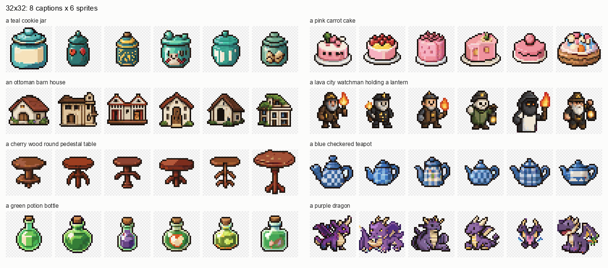
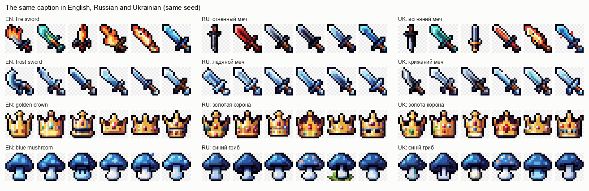

# pixelsprite

Type a caption and get pixel-art sprites at 16×16, 24×24 or 32×32. Captions can be in English, Russian or Ukrainian. You can also draw a silhouette and let the model colour it.



The model is a small autoregressive transformer (39.1M parameters). It draws a sprite one pixel at a time, left to right and top to bottom. For each pixel it picks one of 1,024 palette colours or "transparent". This is the same next-token idea used by text models, applied to pixels instead of words. The weights are on Hugging Face: [`ihor-umanets/pixelsprite-canvas-v2`](https://huggingface.co/ihor-umanets/pixelsprite-canvas-v2).

This repository contains the inference code (Python API, command line, local web UI) and a hands-on learning track (`learn/`) that goes with the article *Through the Thicket to Inference*.

## Install

```bash
pip install "git+https://github.com/umanets/pixelsprite"
# or, from a clone:
git clone https://github.com/umanets/pixelsprite && cd pixelsprite && pip install -e .
```

You need Python 3.10 or newer and PyTorch 2.4 or newer. A GPU is optional: on an 8-thread desktop CPU, 16 sprites take about 6 s at 16×16 and about 1 minute at 32×32. The first run downloads the weights (157 MB) and the multilingual text encoder (about 470 MB).

## Quick start

**Command line**

```bash
pixelsprite "frost sword"                    # 16 sprites 16x16 -> outputs/frost_sword_16_s0/
pixelsprite "a teal cookie jar" --size 32 --n 8 --seed 3
pixelsprite "ледяной меч" --size 24          # Russian; Ukrainian works too
pixelsprite "poison" --mask-file flask.png   # colour your own silhouette (16x16 or 32x32 PNG, alpha = shape)
```

Every run writes each sprite as a PNG at its real size (with transparency) plus an upscaled `sheet.png`.

**Python**

```python
from pixelsprite import SpritePipeline

pipe = SpritePipeline.from_pretrained("ihor-umanets/pixelsprite-canvas-v2")   # or a local folder
result = pipe.generate("golden crown", n=8, size=16, seed=0)
result.save("outputs/crowns")                 # PNGs + sheet.png
first = result.sprites[0]                      # numpy RGBA array, shape (16, 16, 4)

# colour a silhouette: any bool array of shape (size, size)
mask = result.index[0] >= 0
recoloured = pipe.generate("ice crown", n=4, size=16, mask=mask)
```

**Web UI**

```bash
pixelsprite-ui            # http://127.0.0.1:7860 : sizes, guidance sliders, upload or draw a silhouette
```

## Settings

| setting | default | what it does |
|---|---|---|
| `size` | 16 | 16, 24 or 32. The model was trained on 16 and 32. For 24 it draws only inside a 24×24 window in the middle of the 32 canvas. |
| `n`, `seed` | 16, 0 | Number of sprites and the random seed. The same seed gives the same sprites only on the same device with the same `chunk`. |
| `g_shape` | 1.0 | How strongly the **silhouette** follows the caption (classifier-free guidance). 1 keeps shapes and poses as varied as in the data. Higher values make shapes more typical but lose poses: at 2, swords stop being vertical. |
| `g_colour` | 2.0 | How strongly the **colours** follow the caption. 2 hits the named colour in about 80% of sprites. |
| `temperature`, `top_p` | 1.0, 1.0 | Colour sampling only. Below 1 gives fewer, safer colours. |
| `mask` | none | A bool silhouette. The model then only chooses colours, and the outline is kept exactly. |
| `use_filter` | True | Redraws sprites that come out empty or with a detached 1–2 px speck (about 0.1–0.4% of sprites). |



## How it works, in one paragraph

A caption is turned into a 384-number vector by a frozen multilingual sentence encoder ([paraphrase-multilingual-MiniLM-L12-v2](https://huggingface.co/sentence-transformers/paraphrase-multilingual-MiniLM-L12-v2)). The transformer reads a short prefix: the text vector, the canvas size, and one token per row of an optional silhouette. Then it predicts pixels one by one, each from all the pixels before it. Sampling uses a key/value cache, so each new pixel costs one small step instead of re-reading the whole picture. Guidance mixes two predictions, with and without the caption. It is applied separately to the "transparent or not" decision and to the colour choice. The whole story, from data statistics to this model, is told step by step in the article, and `learn/` lets you repeat it.

## Speed

Measured on an RTX 5070 Ti (shared with other programs) and an 8-thread Intel desktop CPU:

| | GPU | CPU |
|---|---|---|
| 16 sprites 16×16 | 3.2 s | 6.4 s |
| 16 sprites 32×32 | 25 s | 58 s |

## Known limitations

- **Pairs of attributes:** "blue flaming mushroom" gives a blue mushroom without fire. The model picks up one attribute word, usually the colour.
- **Pose and size words:** "upright", "pointing down" and "tiny" change little. The training data rarely shows them.
- **Untranslated phrases:** Russian or Ukrainian phrases with no English counterpart in the data can drift. For example, «зелье здоровья» (health potion) gives round red objects, while "health potion" gives flasks.
- **24×24:** this size is a window on the 32 canvas, not a separately trained size.

## Repository layout

```
pixelsprite/      model.py (transformer), sampling.py (guidance, KV cache, filter), pipeline.py, images.py,
                  text.py (encoder), cli.py, webui/ (server.py + index.html)
learn/            notebooks for the article (run on a laptop CPU or free Colab)
tests/            pytest; set PIXELSPRITE_TEST_MODEL=<repo or folder> to also test the real weights
docs/             sample sheets
```

## Licence

The code is Apache-2.0 (`LICENSE`). The model weights are a separate work under **CC BY-NC 4.0** (non-commercial). They were trained on AI-generated sprites:
- [Angais/pixel-art-atlas-1.4m](https://huggingface.co/datasets/Angais/pixel-art-atlas-1.4m): CC0 1.0, made with Krea 2 Turbo. Krea's terms are not waived.
- [azyg0s/pixelart-172k](https://huggingface.co/datasets/azyg0s/pixelart-172k): MIT.

See the model card for details.
